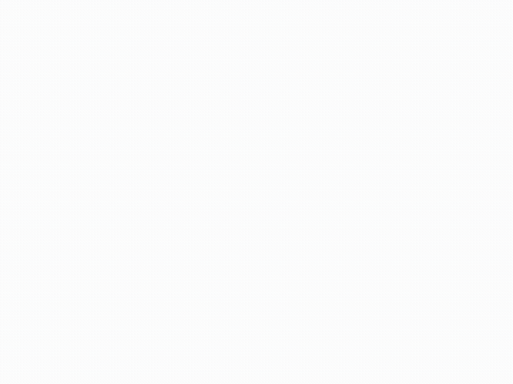
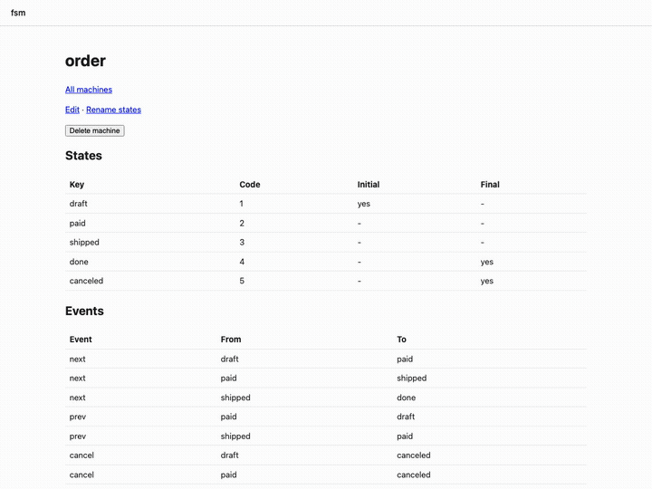

<!-- doc-id: verification-gui -->
<!-- source-sha256: 894d511913634a678de7e8d1cf235aa5c063e723126c86edd24517dd0d423cb0 -->
# GUI 수동 확인

[English](gui.md)

계획(`docs/plans/fsm-v1/plan.md`, Verification; 체크리스트 S-22)의 수동 확인을 실제 browser에서 세 store 각각으로 실행했다. 트리, 단계,
store별 결과를 기록한다.

## 트리와 환경

- 트리: `main`의 commit `bc9f1b1672af370d901b4479bacf64d480833b72`(S-22-1, S-22-2, S-22-3, S-33, S-38의 GUI 코드).
- 명령: checkout에서 `npm install -g --prefix <tmp> --offline`으로 설치한 `fsm-gen`, `fsm-db`, `fsm-gui`(S-18-1), asset은
  `make gui-build`로 빌드.
- Browser: 고정한 Playwright 1.64.0의 Chromium(`make gui-browsers`), headless, 1200 × 900. Mermaid 12.1.0.
- Driver: `packages/gui/scripts/manual-check.mjs`. 아래 단계를 밟고, 영상을 녹화하며, 단계가 실패하면 1로 끝난다.

## 단계

각 store는 order machine과 그 lock 항목을 가진 프로젝트를 받는다. 커밋된 lock이 `lock`과 `save`의 baseline이므로(spec B-3)
json과 mermaid 프로젝트는 git 저장소에 커밋한다:

```sh
mkdir -p json/machines && cp machines/order.fsm.json json/machines/
echo '{"store":"json"}' > json/fsm.config.json
(cd json && fsm-gen lock && fsm-gen copy --to mermaid --root ../mermaid)
echo '{"store":"mermaid"}' > mermaid/fsm.config.json
(cd json && git init -q && git add -A && git commit -qm base)
(cd mermaid && git init -q && git add -A && git commit -qm base)
mkdir db && echo '{"store":"db","dsnEnv":"FSM_DSN"}' > db/fsm.config.json
export FSM_DSN="sqlite://$PWD/db/fsm.sqlite"
(cd db && fsm-db install && fsm-db copy --from json --root ../json)
```

store마다 서버를 띄우고 driver가 단계를 밟은 뒤, 그 store의 check를 실행한다:

```sh
fsm-gui --project json --port 8204 &
(cd packages/gui && node scripts/manual-check.mjs http://127.0.0.1:8204 out-json json)
(cd json && fsm-gen check)
```

단계:

1. 상세 페이지가 다이어그램을 그리고, 모든 state key가 그려진 svg의 label이다.
2. 편집 화면에서 마지막 state 행의 add가 행을 추가하고, 그 code 칸이 제안 code 6을 갖는다.
3. 새 행에 key `refunded`와 `final`을 주고, event `cancel`에 edge shipped → refunded를 더한 뒤 Save가 저장한다: 표에
   `refunded | 6`이 나오고 다이어그램이 그 이름을 보인다.
4. 그 행과 edge에서 remove 뒤 Save: 표에 `refunded`가 없다.
5. 그 뒤 추가한 행은 예약된 6이 아니라 7을 제안한다.
6. 이름 바꾸기 화면이 `paid`에 key `settled`를 준다. 표에 `settled | 2`가 나오고 다이어그램이 그 이름을 보인다.
7. 단계 동안 page 오류와 console 오류가 없다.

## 결과

| Store | 다이어그램의 state 이름 | 제안 code | 저장과 표 | 삭제 | 다음 code | 이름 바꾸기 | `check` |
|---|---|---|---|---|---|---|---|
| json | 있음 | 6 | `refunded \| 6` | 삭제됨 | 7 | `settled \| 2` | `[fsm-gen] check: ok` |
| mermaid | 있음 | 6 | `refunded \| 6` | 삭제됨 | 7 | `settled \| 2` | `[fsm-gen] check: ok` |
| db (SQLite) | 있음 | 6 | `refunded \| 6` | 삭제됨 | 7 | `settled \| 2` | `[fsm-db] check: ok` |

단계 뒤의 lock은 세 store에서 같다: code 1 draft, 2 settled, 3 shipped, 4 done, 5 canceled, 그리고 6은 reserved. driver는 어떤
store에서도 실패와 browser 오류를 보고하지 않았다.

단계의 녹화:






## 확인이 찾은 결함

이 확인의 첫 실행들이 결함을 찾았고, 각각 항목이 되어 위의 실행 전에 고쳐졌다:

- S-22-1: add와 remove 버튼이 form instance만 바꾸고 페이지는 바꾸지 않았다.
- S-22-2: 행 버튼에 style이 없었고 한 행의 두 field가 label Key를 같이 썼다. `/favicon.ico`가 404였다.
- S-22-3: browser 테스트가 network idle을 기다렸다. 새로 받은 Chromium의 첫 탐색이 첫 실행 실패의 원인이다.
- S-38: 정규 Mermaid 형식 `key : code`가 description만으로 그려져 다이어그램이 state key 없이 code만 보였다.
- driver 자신이 처음에는 Mermaid가 label을 그리기 전에 svg를 읽었다. 이제 첫 label을 기다린다.
