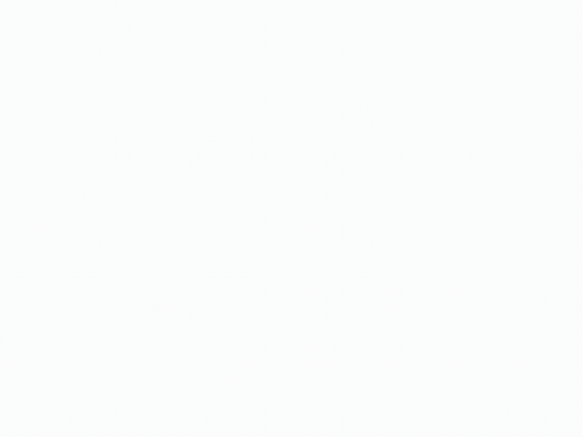

<!-- doc-id: verification-gui -->
# GUI manual check

[한국어](gui.ko.md)

The manual check of the plan (`docs/plans/fsm-v1.md`, Verification; checklist S-22) run in a real browser with each of the
three stores. It records the tree, the steps and the outcome of each store.

## Tree and environment

- Tree: commit `bc9f1b1672af370d901b4479bacf64d480833b72` of `main` (the GUI code of S-22-1, S-22-2, S-22-3, S-33 and S-38).
- Commands: `fsm-gen`, `fsm-db` and `fsm-gui` installed from the checkout with `npm install -g --prefix <tmp> --offline`
  (S-18-1), the assets built with `make gui-build`.
- Browser: the Chromium of the pinned Playwright 1.64.0 (`make gui-browsers`), headless, 1200 × 900; Mermaid 12.1.0.
- Driver: `packages/gui/scripts/manual-check.mjs`, which walks the steps below, records a video and exits 1 when a step
  fails.

## Steps

Each store gets a project with the order machine and its lock entry; the json and mermaid projects are committed to a git
repository, because the committed lock is the baseline of `lock` and `save` (spec B-3):

```sh
mkdir -p json/machines && cp machines/order.fsm.json json/machines/
echo '{"store":"json"}' > json/fsm.config.json
(cd json && fsm-gen lock && fsm-gen copy --to mermaid --root ../mermaid)
echo '{"store":"mermaid"}' > mermaid/fsm.config.json
(cd json && git init -q && git add -A && git commit -qm base)
(cd mermaid && git init -q && git add -A && git commit -qm base)
mkdir db && echo '{"store":"db","dsnEnv":"FSM_DSN"}' > db/fsm.config.json
export FSM_DSN="sqlite://$PWD/db/fsm.sqlite"
(cd db && fsm-db install && fsm-db copy --from json --root ../json)
```

For each store, the server runs and the driver walks it; then the store's own check runs:

```sh
fsm-gui --project json --port 8204 &
(cd packages/gui && node scripts/manual-check.mjs http://127.0.0.1:8204 out-json json)
(cd json && fsm-gen check)
```

The walk:

1. The detail page draws the diagram, and every state key is a label of the drawn svg.
2. On the edit screen, add on the last state row adds a row, and its code field holds the suggested code 6.
3. The new row gets the key `refunded` and `final`, the event `cancel` gets the edge shipped → refunded, and Save stores
   them: the table lists `refunded | 6`, and the diagram names it.
4. Remove on that row and on its edge, then Save: the table no longer lists `refunded`.
5. A row added after that suggests 7, not the reserved 6.
6. The rename screen gives `paid` the key `settled`; the table lists `settled | 2`, and the diagram names it.
7. No page error and no console error during the walk.

## Outcome

| Store | Diagram names the states | Suggested code | Save and table | Remove | Next code | Rename | `check` |
|---|---|---|---|---|---|---|---|
| json | yes | 6 | `refunded \| 6` | removed | 7 | `settled \| 2` | `[fsm-gen] check: ok` |
| mermaid | yes | 6 | `refunded \| 6` | removed | 7 | `settled \| 2` | `[fsm-gen] check: ok` |
| db (SQLite) | yes | 6 | `refunded \| 6` | removed | 7 | `settled \| 2` | `[fsm-db] check: ok` |

The lock after the walk is the same on the three stores: codes 1 draft, 2 settled, 3 shipped, 4 done, 5 canceled, and 6
reserved. The driver reported no failure and no browser error for any store.

Recordings of the walk:




## Defects found by the check

The first runs of this check found defects; each became an item and was fixed before the run above:

- S-22-1: the add and remove buttons changed the form instance but not the page.
- S-22-2: the row buttons had no style and two fields of a row shared the label Key; `/favicon.ico` was a 404.
- S-22-3: the browser test waited for network idleness; the first navigation of a newly downloaded Chromium is the cause of
  its failed first run.
- S-38: the diagram showed the codes and no state key, because the canonical Mermaid form `key : code` is drawn with the
  description only.
- The driver itself first read the svg before Mermaid had drawn its labels; it now waits for the first label.
